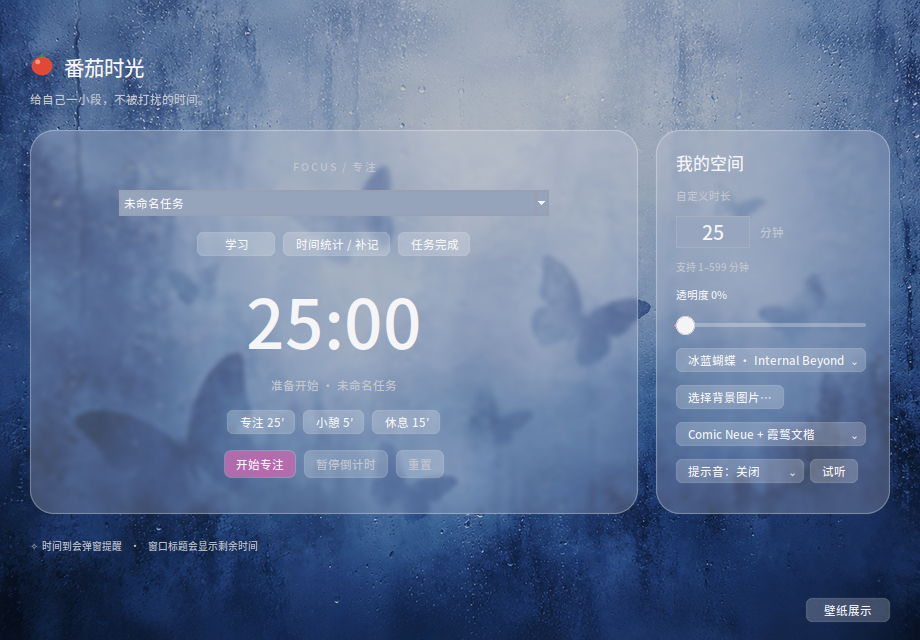

# 🍅 Tomato Glass · Linux 版

复刻 macOS 版主窗口：冰蓝蝴蝶壁纸、毛玻璃卡片、Comic Neue + 霞鹜文楷字体、「专注 / 我的空间」两栏与壁纸展示。



- 专注 25′ / 小憩 5′ / 休息 15′，自定义 1–599 分钟；暂停/继续、重置（提前结束会记录）
- 任务名、分类（学习/工作/休息/其他）、任务完成
- 时间统计 / 补记窗口：今日、本周专注时长，手动补记
- 透明度、主题（冰蓝蝴蝶 / 粉紫渐变 / 自选壁纸）、字体、提示音与试听
- 时间到弹窗 + 桌面通知；关闭后重开会恢复进行中的计时

未移植：菜单栏常驻、动态雨滴涟漪、科研工作台 / 日程 / 看板 / Agent。

## 运行

```bash
sudo apt install python3-tk python3-pil python3-pil.imagetk libnotify-bin
python3 linux/tomato_glass.py      # 需在仓库内运行，以读取 Resources/ 中的壁纸和字体
```

## 安装到应用菜单

```bash
bash linux/install.sh
```

数据：`~/.local/share/tomato-glass/records.json`，设置：`~/.config/tomato-glass/settings.json`。
